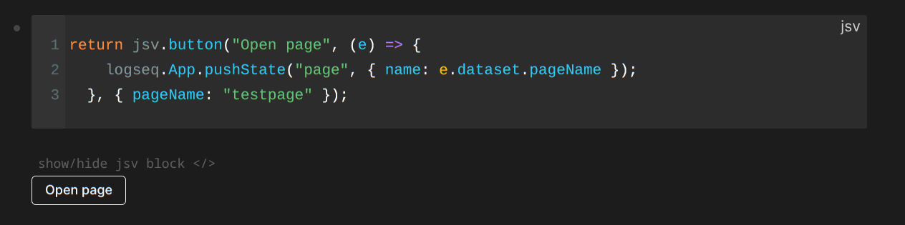

# JSView for Logseq

This Logseq plugin allows you to 

- Query and process pages in your graph through JSView API (or directly through the LogSeq API)
- Process your pages as JSON objects
- Render arbitrary output from a javascript codeblock directly on your page
- Easily create tables and buttons with the built-in JSView

## Getting Started

Install through the Logseq's plugin store, or clone and run `npm run build`

### Trusted Graphs

Before JSView can execute code in a graph, the user needs to mark the graph as *trusted* by adding its path to trustedPaths in the plugin settings.

This is a security measure to prevent JSView blocks in foreign graphs from running automatically and potentially doing damage to your system.
**Only approve graphs whose code you trust.**


Go to settings > plugins > JSView > Trusted Graphs > edit settings.json 

For example:

```JSON
{
  "trustedPaths": [
    "/home/agc/repos/my-graph"
  ],
  "disabled": false
}
```

> Please use the absolute path!

### Creating JSView blocks

Use the command "create new JSV block" (type "/" and enter the command) to create a new block.
It should insert something like this:


You can click out of it and enter anything you want in the codeblock.
This code is run as the body of an `async` function, so you can use `await` and all of logseq's api.

The JSView API is passed to the function as `jsv`, and the logseq api is passed simply as `logseq`.
See the [docs](./docs/) for more info on these.

Whatever is returned by the function (which should have a string representation) is rendered.

Click the hide/show button to collapse the codeblock when you don't want to see it or reveal it again. It's closed by default.



At the moment all JSV blocks are run on launch, and again whenever the code inside it is updated.

Have fun!

## Why?

I came to Logseq after having used Obsidian for years.
I enjoy the graph-based approach but I've found it hard to re-create all the visualizations and interactive
elements that I'd built myself in Obsidian through the Templater and Dataview plugins in the past.

This plugin is meant to bring that customizability back.

The goal of this plugin is not:
- to be as efficient as possible
- to write Datalog queries for you

the JSView plugin simply lets you use the logseq api (as well as helpers through the JSView api) and do whatever you want with your graph/pages/blocks :)

## Styling

Plugin-owned styles live in [src/ui/styles.css](./src/ui/styles.css). The bundler
loads the CSS as text, and [src/index.ts](./src/index.ts) registers it
once through `logseq.provideStyle()` in Logseq's document. JSView uses
`jsv-`-prefixed CSS classes rather than relying on Logseq's utility classes.
Host slot sizing and code visibility rules target only slots containing JSView
output, leaving other plugins' slots alone.

Styles inherit theme colors and use Logseq CSS variables with fallbacks.
Returned HTML and user-supplied table attributes can still provide their own
classes and inline styles; these are not rewritten by JSView.

### Tables

`jsv.table()` adds a 1px underline beneath the header, bold header cells,
and left-aligned cells:

```js
return jsv.table()
  .headers(["Task", "Status"])
  .row(["Publish V1", "Pending"]);
```

Chain `.withoutStyle()` to disable JSView's default table appearance.
This does not reset styles from Logseq or your theme:

```js
return jsv.table({ class: "my-table" })
  .withoutStyle()
  .headers(["Task", "Status"])
  .row(["Publish V1", "Pending"]);
```
