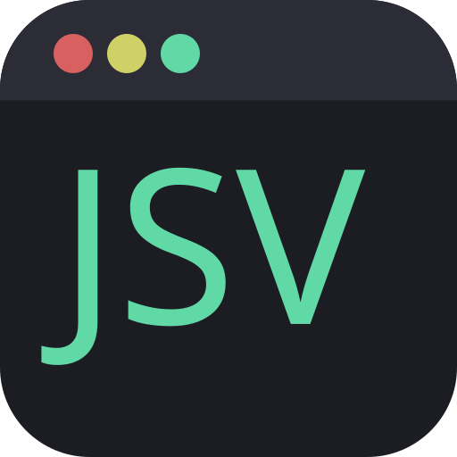
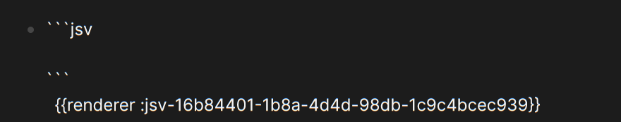
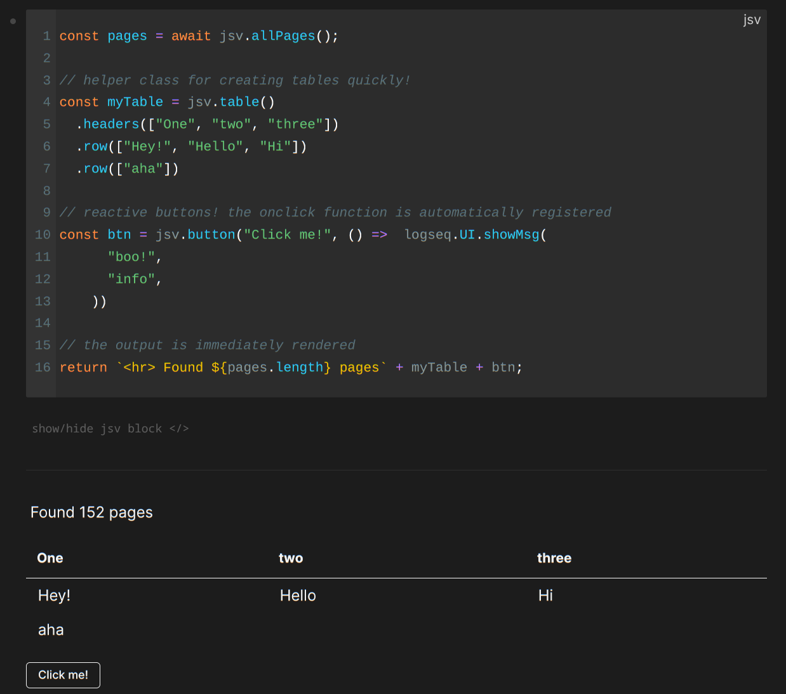

# JSView for Logseq

This Logseq plugin allows you to 

- Query and process pages in your graph through JSView API (or directly through the LogSeq API)
- Process your pages as JSON objects
- Render arbitrary output from a javascript codeblock directly on your page
- Easily create tables and buttons with the built-in JSView

## Getting Started

This is still an early release, so please back up your graph before trying it.

In the future: Install through the Logseq's plugin store.

Or to install manually:

```
git clone https://github.com/KiraGreifeneder/logseq-jsview.git
cd logseq-jsview
npm install && npm run build
```


### Trusted Graphs

Before JSView can execute code in a graph, the user needs to mark the graph as *trusted* by adding its path to trustedPaths in the plugin settings.

This is a security measure to prevent JSView blocks in foreign graphs from running automatically and potentially doing damage to your system.
**Only approve graphs whose code you trust.**


Go to settings > plugins > JSView > Trusted Graphs > edit settings.json 

For example:

```JSON
{
  "trustedPaths": [
    "/home/agc/repos/my-graph"
  ],
  "disabled": false
}
```

Then re-open Logseq or reload it with `Ctrl + R`

> Please use the absolute path!

### Creating JSView blocks

Use the command "New in-line JSView" (type "/" and enter the command) to create a new block.
It should insert something like this:



You can click out of it and enter anything you want in the codeblock.
This code is run as the body of an `async` function, so you can use `await` and all of logseq's api.

The JSView API is passed to the function as `jsv`, and the logseq api is passed simply as `logseq`.
See the [docs](./docs/) for more info on these.

Whatever is returned by the function (which should have a string representation) is rendered.

Click the hide/show button to collapse the codeblock when you don't want to see it or reveal it again. It's closed by default.



At the moment all JSV blocks are run on launch, and again whenever the code inside it is updated.
The ID in the render block must be unique! Therefore I'd recommend only using the command to create JSV blocks. 

Have fun!

## Why?

I came to Logseq after having used Obsidian for years.
I enjoy the graph-based approach but I've found it hard to re-create all the visualizations and interactive
elements that I'd built myself in Obsidian through the Templater and Dataview plugins in the past.

This plugin is meant to bring that customizability back.

The goal of this plugin is not:
- to be as efficient as possible
- to write Datalog queries for you

the JSView plugin simply lets you use the logseq api (as well as helpers through the JSView api) and do whatever you want with your graph/pages/blocks :)

## Documentation

See the online [docs](https://github.com/KiraGreifeneder/logseq-jsview/tree/main/docs).

## License

[MIT](./LICENSE)
